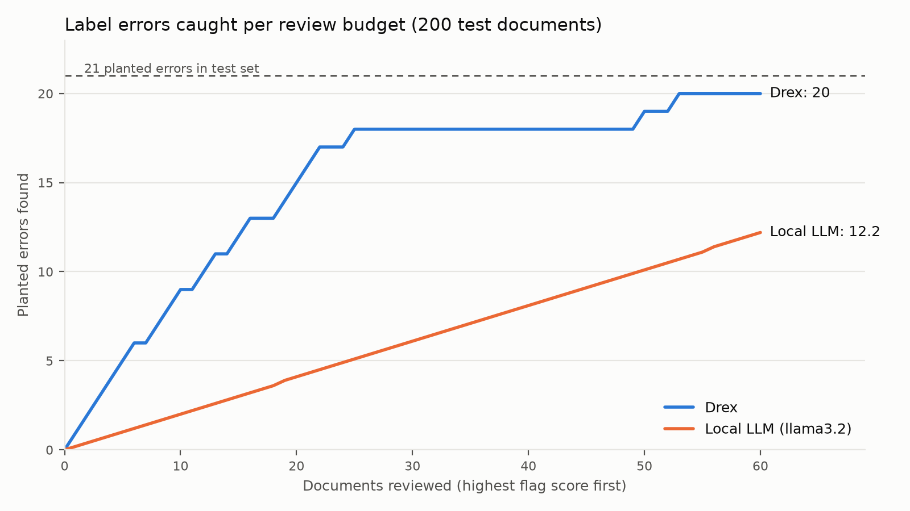

# Cuckoo

**Find mislabeled documents before they poison your dataset.**

Cuckoo parses scanned documents with NDI, asks a decision model (**Drex**, by NACE) to classify each one
**without ever seeing its label**, and flags the documents where Drex confidently disagrees with the
label it was given. A local open LLM runs the same task as a baseline.

> Like a cuckoo's egg in another bird's nest, a mislabeled document looks like it belongs.
> Cuckoo finds it.

---

## How it works

```
scanned docs ──NDI──▶ data/parsed/<doc_id>.json ──┬──▶ Drex (one choice question) ──▶ results/drex.jsonl ─┐
                                                  │                                                     ├─▶ score.py ─▶ metrics.json ─▶ demo/
                                                  └──▶ local LLM baseline (Ollama) ──▶ results/llm.jsonl ─┘
                         data/labels.csv ───────────────────────────────────────────────── (scoring only) ──┘
```

- **Blind setup:** a model only ever receives the document's page-one text and the list of classes.
  Labels are read only at scoring time, never in a model call.
- **One pass, real probabilities:** Drex answers a single choice question ("What type of document
  is this?") and returns a probability for every class, with no generated text to parse.
- **Flag:** a document is flagged when Drex's top class differs from its given label with high
  confidence. The threshold and scoring live in `src/score.py`.
- **Baseline:** a local LLM gets the same text and classes and returns `{"label", "confidence"}` as JSON.

## Repo layout

| Path | What |
|---|---|
| `config.py` | Classes, paths, seed, noise rate, prices |
| `src/make_noise.py` | Builds the 300-scan dataset from RVL-CDIP and plants label errors -> `data/labels.csv` |
| `src/ingest_ndi.py` | Parses each scan with NDI (Nace Document Intelligence) -> `data/parsed/<doc_id>.json` |
| `src/drex_client.py` | Drex client: `classify(text, classes) -> probs`; also key check and go/no-go |
| `src/llm_client.py` | Local LLM baseline via Ollama |
| `src/run_eval.py` | Runs a model over every parsed doc (resumable) -> `results/drex.jsonl`, `results/llm.jsonl` |
| `src/score.py` | Flags, thresholds, metrics -> `results/metrics.json` |
| `src/charts.py` | Budget curve -> `results/charts/budget_curve.png` |
| `src/app.py` | Demo server: page + live upload analysis (`/api/analyze`) |
| `demo/index.html`, `demo/top.js` | Demo page, filled from `metrics.json` |

## Setup

Requires Python 3.11+ and [Ollama](https://ollama.com).

```bash
python3 -m venv .venv
.venv/bin/pip install -r requirements.txt
cp .env.example .env          # then fill in NACE_API_KEY (never commit .env)
ollama serve                  # or open the Ollama app
ollama pull llama3.2          # baseline model; override with LOCAL_MODEL in .env
```

`.env` keys:

| Key | Purpose |
|---|---|
| `NACE_API_KEY` | Drex API key from console.nace.ai (`nace_sk_...`) |
| `LOCAL_MODEL` | Ollama model for the baseline (default `llama3.2`) |
| `OLLAMA_URL` | Ollama server (default `http://localhost:11434`) |

## Usage

```bash
# check the Drex key (free, no billing)
.venv/bin/python src/drex_client.py --check

# smoke-test the local LLM
.venv/bin/python src/llm_client.py

# go / no-go: Drex on the first 20 parsed docs vs. true labels
.venv/bin/python src/drex_client.py 20

# full runs (resumable: re-run to pick up new or failed docs)
.venv/bin/python src/run_eval.py --model drex            # 8 concurrent by default
.venv/bin/python src/run_eval.py --model llm             # 1 at a time (Ollama is serial)
.venv/bin/python src/run_eval.py --model drex --limit 20 # partial run

# validate outputs: line count, duplicate doc_ids, null probs/labels
.venv/bin/python src/run_eval.py --model drex --check
.venv/bin/python src/run_eval.py --model llm --check
```

### Full pipeline

```bash
curl -L -o data/raw/train.parquet https://huggingface.co/datasets/jordyvl/rvl_cdip_100_examples_per_class/resolve/main/data/train-00000-of-00001-81f1d229db782541.parquet
.venv/bin/python src/make_noise.py      # 300 scans + labels.csv (30 labels flipped, dev/test split)
.venv/bin/python src/ingest_ndi.py      # NDI parse, resumable (~$0.0035 per page at parse_mode low)
.venv/bin/python src/run_eval.py --model drex
.venv/bin/python src/run_eval.py --model llm
.venv/bin/python src/score.py           # -> results/metrics.json
.venv/bin/python src/charts.py          # -> results/charts/budget_curve.png
```

### Demo app

```bash
.venv/bin/python src/app.py     # then open http://localhost:8000/demo/
```

`src/app.py` serves the demo page and a local `/api/analyze` endpoint: upload a PDF or scan and it runs
NDI -> Drex and the local LLM live, so the API key never reaches the browser. The page also works on any
static server, but without the app the upload section is disabled.

## Data contracts

**Input**: `data/parsed/<doc_id>.json`
```json
{"doc_id": "...", "text": "<page one text>", "source": "..."}
```

**Output**: one JSON line per document. These formats are fixed; scoring depends on them.
```jsonc
// results/drex.jsonl
{"doc_id": "...", "probs": {"<class>": 0.0, ...}, "latency_ms": 0, "input_tokens": 0}
// results/llm.jsonl   (label/confidence are null if the reply could not be parsed)
{"doc_id": "...", "label": "<class>", "confidence": 0, "latency_ms": 0, "input_tokens": 0, "output_tokens": 0}
```

**Metrics**: `results/metrics.json`, read by `demo/top.js`
`n_test`, `n_planted_errors_test`, `threshold`, `drex{...}` and `llm{...}` (each with `errors_found`,
`false_alarms`, `recall`, `precision`, `budget_curve{"5","10","20"}`, `latency_p50_ms`,
`latency_p95_ms`, `cost_per_1k_docs`), and `top_flags[]` (`doc_id`, `given_label`, `drex_top`,
`drex_probs`, `flag_score`, `flipped`).

## Models

| | Drex | Baseline |
|---|---|---|
| Served by | NACE hosted API (`POST /v1/systemone`) | Ollama, on the local machine |
| Model | `drex-latest` (currently `drex-max-v1.1`) | `llama3.2` (configurable) |
| Output | probability per class | JSON `{label, confidence 0-100}`, schema-constrained, temperature 0 |
| Cost | billed per input token only | no per-token cost |
| Retries | backoff on 429/500/503/529, honours `retry-after-ms` | backoff on connection/HTTP errors; one retry on unparseable reply |

## Results

From `results/metrics.json`: 200 held-out test documents containing 21 planted label errors. Each
model's flag threshold was chosen on a separate 100-document dev split.

| | Drex | Local LLM (llama3.2) |
|---|---|---|
| Planted errors flagged | 18 / 21 | 16 / 21 |
| False alarms | 7 | 61 |
| Precision / recall | 0.72 / 0.857 | 0.208 / 0.762 |
| Errors in top 5 / 10 / 20 flags | 5 / 9 / 15 | 1 / 2 / 4.1 |
| Classification accuracy vs true class | 0.785 | 0.605 |
| Median / p95 latency per doc | 306 / 480 ms | 561 / 1242 ms |
| Cost per 1k docs | not set (see `config.py`) | $0 (local) |

- Drex flag score = 1 - P(given label); LLM flag score = confidence/100 when its label differs from the given label.
- Top-K counts break score ties at random (expected value), because the LLM reports confidence 100 on
  274 of 300 documents.



## Limitations

- The baseline is a small local model, not a frontier LLM, so the comparison is against an open model
  running on a laptop.
- Drex classifies 78.5% of test pages correctly; its false alarms are its own misclassifications.
- Documents with empty text (failed OCR) still get a confident class from both models. `run_eval.py`
  lists them (none occurred in this run).
- Data is RVL-CDIP (1990s tobacco-industry scans), so it may not represent modern documents.
- Latency for the local baseline depends on the machine it runs on.

## Workflow

- Work on branch `models`, merge into `main` at each hand-off, push. Never commit `.env` or API keys.
- `data/raw/` (scans and parquet) is not committed; `make_noise.py` rebuilds it.
